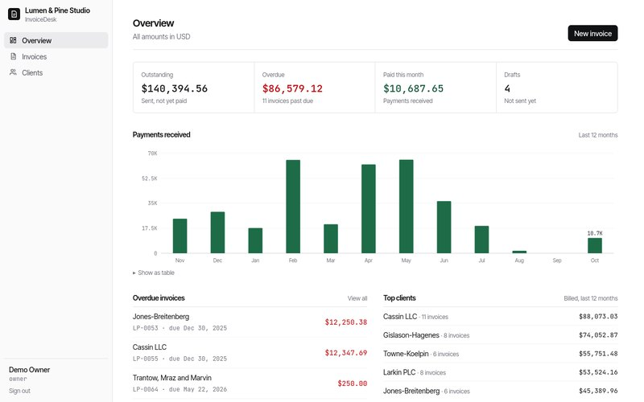
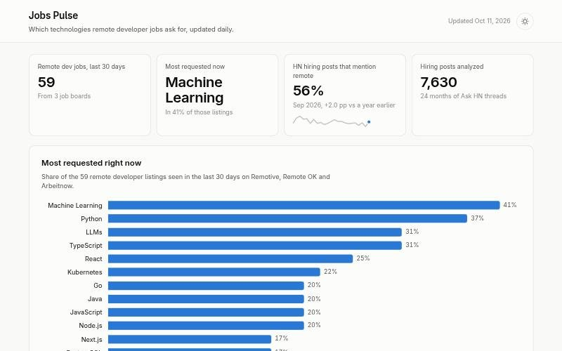
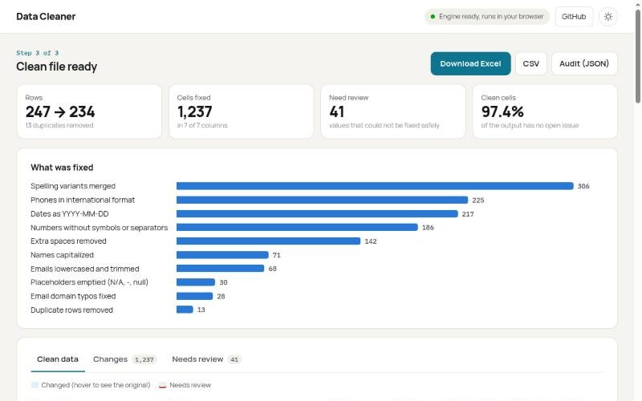

<!-- Este archivo va en un repo llamado exactamente igual que tu usuario: github.com/JoseMayo16/JoseMayo16 -->

  

**[English](#english)** &nbsp;·&nbsp; **[Español](#español)**

---

## English

I build custom web apps, APIs and automations with **Laravel**, **Vue**, **Python** and **n8n** for
businesses and teams that need something made for them, from a single API to a full admin
dashboard.

| **~3 years** | **SENA** | **n8n · Airtable** | **UTC-5** |
|:-:|:-:|:-:|:-:|
| of work experience | Software Development Technologist | automation in production | overlaps US and Canada hours |

### About me

- **Pase Seguro S.A.S** (Jan 2026 - Jun 2026), Full-Stack Developer: web solutions,
  automations and integrations between tools, internal systems support.
- **Universidad de Antioquia** (Oct 2023 - Dec 2025), Full-Stack and Automation Developer:
  WordPress, FlutterFlow, SQL and automations with **n8n, Monday and Airtable**. For example,
  n8n workflows that take every Fillout form submission, filter and clean the data, and
  create or update the matching record in Airtable, so nobody copies data by hand.
- **Small businesses:** websites to present and sell their business.
- **Languages:** Spanish (native), English (conversational).
- **Security-minded:** I'm into cybersecurity, and it shows in how I build. Validation,
  authentication and data isolation come first, not at the end.
- **Off the clock:** gaming.

### What I can build for you

| | |
|---|---|
| **Custom web apps** | Admin dashboards, inventory, booking, internal tools. Laravel backend, Vue frontend. |
| **APIs and backends** | REST APIs with validation, authentication and a well-modeled database, ready to plug into your site or app. |
| **Automation and integrations** | n8n workflows, forms connected to Airtable or Monday, syncing data between apps, Python scripts and scraping. |
| **Websites and landing pages** | Hand-coded or WordPress: fast, mobile-friendly and easy to maintain. |

### Featured projects

<table>
<tr>
<td width="33%" valign="top">

<h4><a href="https://github.com/JoseMayo16/invoice-desk">InvoiceDesk</a></h4>
Invoicing for freelancers and studios: PDF invoices, email delivery and card payments with Stripe.
  
<b>Laravel 13 · Vue 3 · TypeScript · Stripe</b>
 
Per-company data isolation, signed and idempotent webhook, 56 tests.
</td>
<td width="33%" valign="top">

<h4><a href="https://github.com/JoseMayo16/jobs-pulse">Jobs Pulse</a> · <a href="https://josemayo16.github.io/jobs-pulse/">live</a></h4>
Tracks which technologies remote job posts ask for and publishes a trends dashboard.
  
<b>Python · SQLite · GitHub Actions</b>
 
Runs itself every day, at no cost.
</td>
<td width="33%" valign="top">

<h4><a href="https://github.com/JoseMayo16/data-cleaner">Data Cleaner</a> · <a href="https://josemayo16.github.io/data-cleaner/">live</a></h4>
Cleans messy CSV and Excel files: duplicates, spelling variants, emails, phones, dates.
  
<b>Python · Pyodide · WebAssembly</b>
 
Runs in the browser: the file never leaves your computer.
</td>
</tr>
</table>

### How I work

| 1. We talk | 2. Proposal | 3. Build | 4. Delivery |
|---|---|---|---|
| You tell me what you need and I ask questions until the scope is clear to both of us. | You get in writing what will be delivered, how long it takes and what it costs. | You see progress every week on a link you can check anytime. | The code lives in your repository, with usage instructions and an agreed support period. |

### Let's talk

Send me a short description of what you need and I'll reply with questions or a first proposal:
**[email](mailto:jnjsmayo@gmail.com)** · **[WhatsApp](https://wa.me/573016612888)** · **[LinkedIn](https://www.linkedin.com/in/juan-jos%C3%A9-mayo-m-1682252b2)** · **[portfolio](https://josemayo16.github.io)**

---

## Español

Construyo aplicaciones a medida, APIs y automatizaciones con **Laravel**, **Vue**, **Python** y **n8n**
para negocios y equipos que necesitan algo hecho a la medida, desde una API hasta un panel
administrativo completo.

| **~3 años** | **SENA** | **n8n · Airtable** | **UTC-5** |
|:-:|:-:|:-:|:-:|
| de experiencia laboral | Tecnólogo en Desarrollo de Software | automatización en producción | horario compatible con EE. UU. y Canadá |

### Sobre mí

- **Pase Seguro S.A.S** (ene 2026 - jun 2026), Desarrollador Full-Stack: soluciones web,
  automatizaciones e integraciones entre herramientas, soporte de sistemas internos.
- **Universidad de Antioquia** (oct 2023 - dic 2025), Desarrollador Full-Stack y Automatización:
  WordPress, FlutterFlow, SQL y automatizaciones con **n8n, Monday y Airtable**. Por ejemplo,
  flujos en n8n que toman cada respuesta de un formulario de Fillout, filtran y limpian los
  datos, y crean o actualizan el registro en Airtable, sin que nadie copie datos a mano.
- **Pequeñas empresas:** páginas web para presentar y vender su negocio.
- **Idiomas:** español (nativo), inglés (conversacional).
- **Con mentalidad de seguridad:** me interesa la ciberseguridad y se nota en cómo construyo.
  Validación, autenticación y aislamiento de datos van primero, no al final.
- **Fuera del trabajo:** los videojuegos.

### En qué te puedo ayudar

| | |
|---|---|
| **Aplicaciones web a medida** | Paneles administrativos, inventarios, reservas, gestión interna. Backend en Laravel, interfaz en Vue. |
| **APIs y backends** | APIs REST con validación, autenticación y una base de datos bien modelada, listas para conectar con tu web o app. |
| **Automatización e integraciones** | Flujos en n8n, formularios conectados a Airtable o Monday, sincronización de datos entre apps, scripts en Python y scraping. |
| **Sitios y landing pages** | En código o en WordPress: rápidos, adaptados a celular y fáciles de mantener. |

### Proyectos destacados

<table>
<tr>
<td width="33%" valign="top">

<h4><a href="https://github.com/JoseMayo16/invoice-desk">InvoiceDesk</a></h4>
Facturación para freelancers y estudios: facturas en PDF, envío por correo y pago con tarjeta vía Stripe.
  
<b>Laravel 13 · Vue 3 · TypeScript · Stripe</b>
 
Datos aislados por empresa, webhook firmado e idempotente, 56 tests.
</td>
<td width="33%" valign="top">

<h4><a href="https://github.com/JoseMayo16/jobs-pulse">Jobs Pulse</a> · <a href="https://josemayo16.github.io/jobs-pulse/">demo</a></h4>
Rastrea qué tecnologías piden las ofertas remotas y publica un dashboard de tendencias.
  
<b>Python · SQLite · GitHub Actions</b>
 
Corre solo cada día, sin costo.
</td>
<td width="33%" valign="top">

<h4><a href="https://github.com/JoseMayo16/data-cleaner">Data Cleaner</a> · <a href="https://josemayo16.github.io/data-cleaner/">demo</a></h4>
Limpia archivos CSV y Excel desordenados: duplicados, variantes de escritura, correos, teléfonos, fechas.
  
<b>Python · Pyodide · WebAssembly</b>
 
Corre en el navegador: el archivo nunca sale de tu computador.
</td>
</tr>
</table>

### Cómo trabajo

| 1. Conversamos | 2. Propuesta | 3. Construcción | 4. Entrega |
|---|---|---|---|
| Me cuentas qué necesitas y hago preguntas hasta que el alcance quede claro para los dos. | Recibes por escrito qué se entrega, en cuánto tiempo y a qué precio. | Ves avances cada semana en un enlace que puedes revisar cuando quieras. | El código queda en tu repositorio, con instrucciones de uso y un periodo de soporte acordado. |

### Hablemos

Escríbeme con una descripción corta de lo que necesitas y te respondo con preguntas o una primera propuesta:
**[correo](mailto:jnjsmayo@gmail.com)** · **[WhatsApp](https://wa.me/573016612888)** · **[LinkedIn](https://www.linkedin.com/in/juan-jos%C3%A9-mayo-m-1682252b2)** · **[portafolio](https://josemayo16.github.io)**
